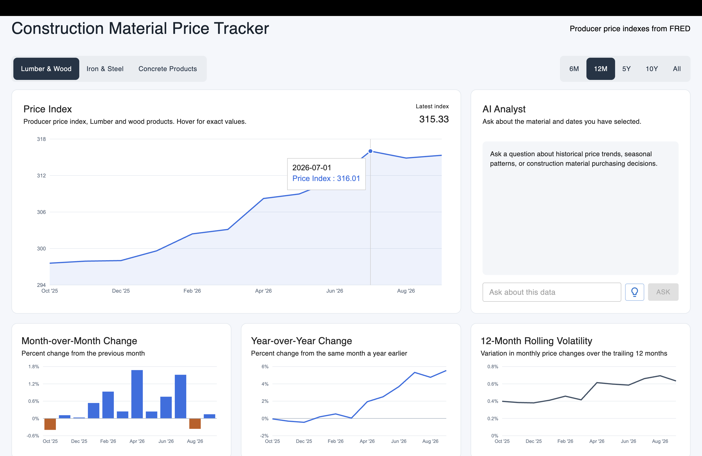

# Construction Material Price Tracker <!-- omit in toc -->

## Table of Contents <!-- omit in toc -->

- [1. Overview](#1-overview)
- [2. Features](#2-features)
  - [Application Preview](#application-preview)
- [3. Design \& Implementation](#3-design--implementation)
  - [Architecture](#architecture)
    - [System Architecture](#system-architecture)
  - [Data Processing](#data-processing)
  - [AI Analyst Integration](#ai-analyst-integration)
  - [Design Decisions](#design-decisions)
- [4. AI Usage \& Development Process](#4-ai-usage--development-process)
  - [Why I Chose the AI Analyst](#why-i-chose-the-ai-analyst)
  - [My Contributions](#my-contributions)
  - [How ChatGPT Assisted](#how-chatgpt-assisted)
  - [Where I Stepped In](#where-i-stepped-in)
  - [Verification \& Testing](#verification--testing)
- [5. Data \& Calculations](#5-data--calculations)
  - [Data Sources](#data-sources)
  - [Calculated Metrics](#calculated-metrics)
- [6. Testing \& Validation](#6-testing--validation)
  - [Automated Tests](#automated-tests)
  - [API Testing](#api-testing)
  - [Dashboard Testing](#dashboard-testing)
  - [AI Analyst Evaluation](#ai-analyst-evaluation)
- [7. Limitations \& Future Improvements](#7-limitations--future-improvements)
  - [Current Limitations](#current-limitations)
  - [Future Improvements](#future-improvements)
- [8. Getting Started](#8-getting-started)
  - [Prerequisites](#prerequisites)
  - [Installation](#installation)
  - [Notes](#notes)

## 1. Overview

A web application that visualizes historical construction material price trends using FRED Producer Price Index (PPI) data for lumber, steel, and concrete. Includes an AI Analyst to help users interpret trends and explore construction budget scenarios.

## 2. Features

- **Interactive Dashboard:** Visualize historical price indices for lumber, steel, and concrete with selectable date ranges.
- **Price Metrics:** Track month-over-month (MoM), year-over-year (YoY), and 12-month rolling volatility.
- **AI Analyst:** Ask questions about historical price trends, compare materials, and calculate hypothetical construction budget scenarios.

### Application Preview



## 3. Design & Implementation

### Architecture

The application follows a client-server architecture:

- **Frontend:** React with Vite, Material UI, and Recharts for the dashboard and interactive visualizations.
- **Backend:** Node.js and Express for processing data, calculating metrics, and providing REST API endpoints.
- **AI Integration:** Groq API for generating responses to user questions using historical material data.

#### System Architecture

```text
FRED CSV Files
      |
      v
CSV Parsing & Cleaning
      |
      v
Metric Calculations & Cache
      |
      v
Express Backend (REST API)
      |
      +--------------------+
      |                    |
      v                    v
React Dashboard        Groq API
(MUI + Recharts)       (AI Analyst)
```


### Data Processing

The backend handles data preparation and metric calculations before sending the results to the frontend. This process includes the following steps:

- Historical PPI data is loaded from FRED CSV files using PapaParse.
- Data is cleaned, validated, and sorted chronologically.
- Month-over-month (MoM), year-over-year (YoY), and rolling volatility metrics are calculated on the backend.
- Processed data is cached to avoid repeating calculations for each request.

### AI Analyst Integration

The AI Analyst uses the Groq API to answer user questions using historical material data and metrics calculated by the backend.

The integration follows this workflow:

1. **User Request:** The user submits a question through the AI Analyst interface.
2. **Backend Processing:** The React frontend sends the request to the Express backend.
3. **Data Context:** The backend prepares relevant historical data and precomputed metrics (MoM, YoY, and volatility) to provide context for the LLM.
4. **LLM Response:** The Groq API processes the question and supplied context to generate a response.
5. **Display Results:** The response is returned through the backend and displayed in the AI Analyst interface.

By supplying calculated metrics directly to the LLM, the application reduces its reliance on independently estimating historical values. Users can also explore hypothetical construction budget scenarios using their own cost estimates and percentage changes.

### Design Decisions

Several design decisions were made to keep the application simple, maintainable, and easy to use:

- Used a dashboard layout to present price trends and metrics in one place.
- Added material and date-range filters to make historical data easier to explore.
- Kept data processing on the backend to separate calculations from visualization.
- Designed the AI Analyst to use supplied historical data and acknowledge its limitations rather than make unsupported market predictions.


## 4. AI Usage & Development Process

I used ChatGPT throughout development to help with implementation, debugging, and testing. Rather than generating the entire application at once, I worked on the project incrementally, reviewing the code and testing each component before moving on to the next.

### Why I Chose the AI Analyst

While charts help users visualize changes, they do not necessarily explain what those changes could mean for a construction project. I wanted the application to be useful beyond displaying historical price trends.

I chose to build an AI Analyst with contractors and project managers in mind. Users can ask questions about material trends, compare historical changes, and explore how hypothetical price increases could affect their project budgets.

I also wanted the AI to recognize the limitations of the available data. Its responses are intended to support purchasing decisions, not predict future prices or make claims about market conditions that the historical data cannot verify.

For example, a contractor planning a construction project could ask:

- **Budget Impact:** "I have a $50,000 steel budget. How would a 10% increase in steel costs affect my project?"
- **Historical Trends:** "How have lumber prices changed over the past 12 months?"
- **Material Comparison:** "Which material has experienced the most volatility over the past year?"
- **Project Planning:** "If my lumber budget is $30,000 and my steel budget is $40,000, how would a 5% increase in both affect my total costs?"

These questions demonstrate how the AI Analyst can help users connect historical material trends to hypothetical project costs and planning decisions.

### My Contributions

I made the main decisions regarding the application's structure, functionality, and user experience.

- **Application Design:** I chose the React and Express architecture, planned the dashboard layout, and decided how users would interact with the charts and filters.
- **Data Processing:** I worked through CSV parsing, data validation, and metric calculations to understand how the historical data should be processed.
- **Implementation Review:** I reviewed the generated code throughout development, requested changes when the implementation did not match my requirements, and tested the application as features were added.

### How ChatGPT Assisted

ChatGPT helped translate my requirements and design decisions into working code. Its assistance included:

- Providing guidance for setting up the React frontend and Express backend.
- Helping implement the dashboard components, charts, filters, and responsive layout using Material UI and Recharts.
- Assisting with backend functions for processing historical data and calculating price metrics.
- Helping integrate the Groq API and structure the historical data provided to the AI Analyst.
- Suggesting test cases, debugging approaches, and improvements to the AI Analyst's instructions.

ChatGPT was particularly useful for frontend development, where it helped me implement the interface more efficiently while I focused on the overall design and functionality.

### Where I Stepped In

Although ChatGPT helped with implementation, I did not accept every suggestion without reviewing them.

- **Frontend Design:** I evaluated the generated layout and requested changes when components did not fit the design I wanted. For example, I chose to remove the sidebar in favor of a simpler dashboard layout and adjusted the placement of the AI Analyst.
- **Data Calculations:** I reviewed how MoM, YoY, and volatility were calculated, including how missing observations and insufficient historical data should be handled.
- **AI Accuracy:** During testing, I found that the AI Analyst sometimes confused percentage changes with index-point changes. It also suggested possible causes for historical price movements without sufficient evidence. I refined the AI instructions to distinguish these measurements and acknowledge when the data could not support a conclusion.
- **Historical Values:** I identified an instance where the AI Analyst reported an incorrect historical index value. I added instructions requiring it to use the exact values supplied in the dataset rather than estimate missing information.

### Verification & Testing

I verified ChatGPT-assisted implementations through automated tests, manual API checks, and dashboard testing. I also evaluated the AI Analyst's responses against the historical dataset and independently calculated values, refining its instructions when I identified inaccuracies.

These checks helped me identify issues that were not immediately apparent from the generated code. Detailed test coverage and results are documented in Section 6.


## 5. Data & Calculations

### Data Sources

The application uses monthly Producer Price Index (PPI) data downloaded from the Federal Reserve Economic Data (FRED) database.

| Material               | FRED Series | Source                                            |
| ---------------------- | ----------- | ------------------------------------------------- |
| Lumber & Wood Products | WPU08       | [FRED](https://fred.stlouisfed.org/series/WPU08)  |
| Iron & Steel           | WPU101      | [FRED](https://fred.stlouisfed.org/series/WPU101) |
| Concrete Products      | WPU133      | [FRED](https://fred.stlouisfed.org/series/WPU133) |

The included CSV files contain historical observations from January 1926 through September 2026. These values represent price indices, not actual retail material prices.

### Calculated Metrics

The backend calculates three metrics for each material:

**Month-over-Month (MoM)**

Measures the percentage change from the previous month.

$$
MoM = \frac{P_t - P_{t-1}}{P_{t-1}} \times 100
$$

**Year-over-Year (YoY)**

Measures the percentage change from the same month in the previous year.

$$
YoY = \frac{P_t - P_{t-12}}{P_{t-12}} \times 100
$$

**12-Month Rolling Volatility**

Measures the variation in monthly percentage changes using the population standard deviation of the previous 12 MoM values.

$$
\sigma = \sqrt{\frac{1}{12}\sum_{i=1}^{12}(r_i-\bar{r})^2}
$$

Where:
- \(P_t\) is the price index for the current month.
- \(r_i\) represents a monthly percentage change.
- \(\bar{r}\) is the average of the 12 monthly percentage changes.

If the required historical observations are unavailable, the corresponding metric is returned as `null` rather than estimating missing values.


## 6. Testing & Validation

Testing was performed throughout development to verify data accuracy, API functionality, dashboard behavior, and AI-generated responses.

### Automated Tests

I used Node.js's built-in test runner to test the backend calculations and CSV parsing.

| Component | Tests | Results |
|---|---|---|
| Price Metric Calculations | 10 | Passed |
| CSV Parsing & Validation | 5 | Passed |
| **Total** | **15** | **Passed** |

The tests cover:
- MoM and YoY percentage calculations.
- Rolling volatility calculations.
- Missing observations and insufficient historical data.
- Zero-value handling and invalid inputs.
- CSV loading, data validation, and chronological sorting.

To run the automated tests:

```bash
cd server
node --test tests/*.test.js
```

### API Testing

I manually tested the backend endpoints using `curl`.

**8 API checks passed**, including:
- Successful retrieval of lumber, steel, and concrete data.
- Error handling for invalid material selections.
- Validation of missing questions, invalid materials, invalid date ranges, and malformed conversation history.

### Dashboard Testing

I manually checked the dashboard's charts and filters across different date ranges. I also compared displayed values against independently calculated results to verify the accuracy of MoM, YoY, and volatility metrics.

### AI Analyst Evaluation

I tested the AI Analyst using questions about historical trends, material comparisons, construction budgets, and uncertainty.

During testing, I identified issues involving percentage units, unsupported explanations for price movements, and incorrect historical index values. I refined the AI instructions and retested the affected scenarios.

For example, the AI Analyst correctly returned the March and April 2026 lumber indices (303.138 and 308.224) and the corresponding April MoM change (+1.68%) after refinement.

These tests helped verify the AI Analyst's behavior for the evaluated scenarios, although generated responses may still contain inaccuracies.


## 7. Limitations & Future Improvements

### Current Limitations

- **Historical Data:** Since the application uses downloaded FRED CSV files rather than live data, the latest available observation in the included datasets is September 2026.
- **AI Accuracy:** The AI Analyst relies on the historical data provided by the backend. It cannot independently verify external market conditions or determine the causes of price changes. Although its instructions are designed to prevent unsupported conclusions, AI-generated responses may still contain inaccuracies.
- **Forecasting:** The application focuses on historical analysis and does not currently implement a predictive forecasting model.

### Future Improvements

Given more development time, I would consider:

- **Additional Materials:** Expanding the dashboard to support more construction material categories.
- **Improved AI Validation:** Adding automated checks to verify numerical values in AI-generated responses against the source data.
- **Forecasting:** Exploring statistical forecasting methods to provide estimates of future trends, with clear explanations of their uncertainty.


## 8. Getting Started

### Prerequisites

- Node.js and npm
- A Groq API key for the AI Analyst feature

### Installation

1. Clone the repository:

   ```bash
   git clone https://github.com/Dannaanore/construction-material-price-tracker.git
   cd construction-material-price-tracker
   ```

2. Install backend dependencies:

   ```bash
   cd server
   npm install
   ```

3. Create a `.env` file in the `server` directory:

   ```env
   GROQ_API_KEY=your_groq_api_key
   ```

4. Start the backend:

   ```bash
   npm run dev
   ```

5. Open a second terminal and navigate to the `client` directory of the cloned repository:

   ```bash
   cd /path/to/construction-material-price-tracker/client
   npm install
   ```

6. Start the frontend:

   ```bash
   npm run dev
   ```

7. Open the local URL displayed by Vite (typically `http://localhost:5173`).

### Notes

- The backend runs on `http://localhost:3001`.
- Historical price data and dashboard charts do not require a Groq API key, but the AI Analyst feature does.
- Keep your `.env` file private and do not commit API keys to GitHub.
